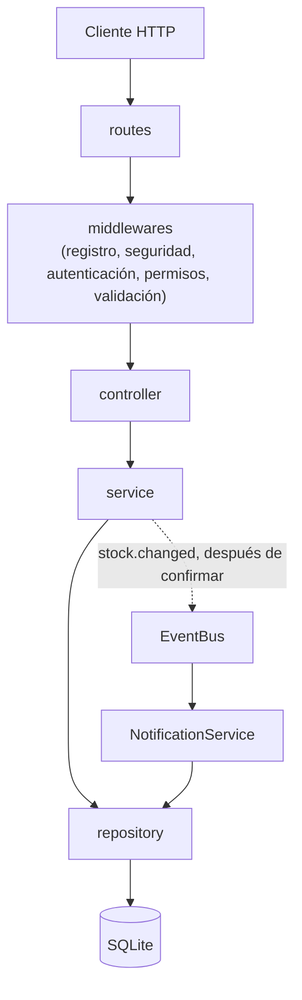
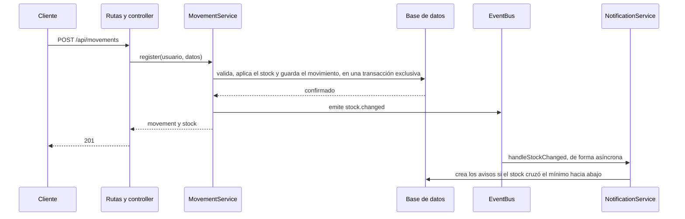
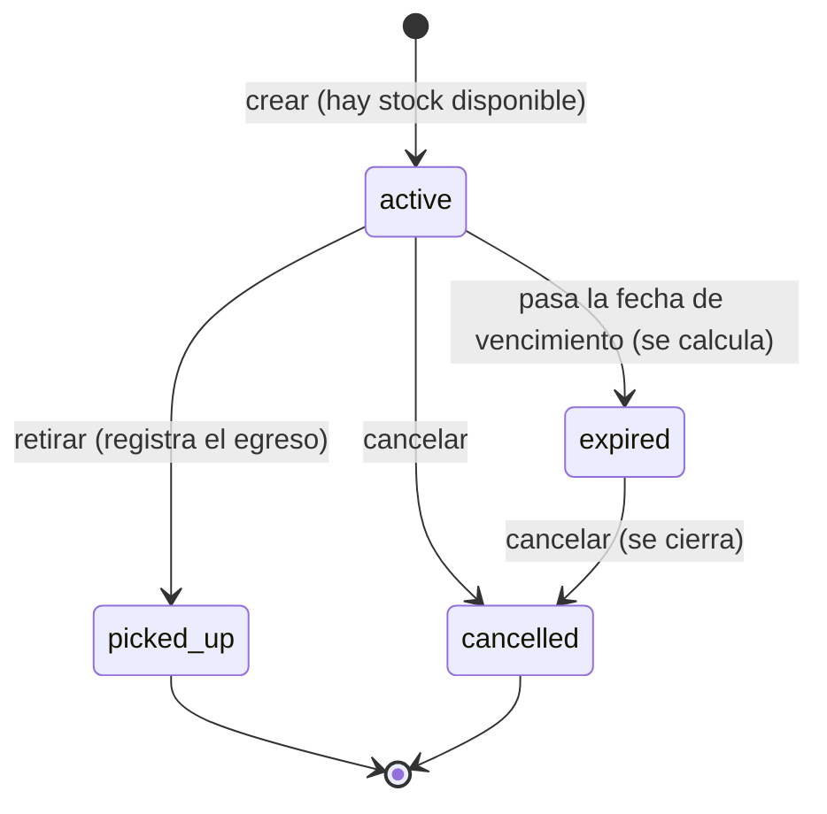

# Documentación técnica del backend

Referencias: [referencia de la API](referencia-api.md) y [decisiones de diseño](desiciones-diseno.md).

## 1. Comandos útiles

Todos los comandos se corren con `npm run <comando>`, parado en `server/`.

| Comando | Función |
| --- | --- |
| `dev` | Levanta el servidor en desarrollo con recarga automática |
| `clean` | Borra la carpeta `dist/` |
| `build` | Borra `dist/` y compila el proyecto (si hay un error de tipos, no compila) |
| `start` | Arranca la versión compilada (`node dist/index.js`); hay que haber corrido `build` |
| `typecheck` | Chequea los tipos en `src/` y en `tests/` |
| `test` | Corre toda la suite de pruebas con Vitest (`vitest run`) |
| `test:unit` | Corre solo las pruebas unitarias (`tests/unit`) |
| `test:integration` | Corre solo las pruebas de integración (`tests/integration`) |
| `test:coverage` | Corre las pruebas y genera el reporte de cobertura (`v8`, en consola y HTML) |
| `test:watch` | Corre Vitest en modo observación para desarrollo |
| `migrate`, `migrate:down`, `migrate:status` | Aplica las migraciones, revierte la última, muestra el estado |
| `migrate:prod` | Aplica las migraciones con la versión compilada |
| `create-owner`, `create-owner:prod` | Crea el primer dueño (las versiones `:prod` usan lo compilado, sin `tsx`) |
| `reset-owner-password`, `reset-owner-password:prod` | Recupera la contraseña de un dueño y cierra sus sesiones |

Notas:

- El servidor aplica las migraciones pendientes al arrancar; `migrate` sirve para hacerlo o consultarlas sin levantarlo. `create-owner` y `reset-owner-password` también las aplican antes de empezar.
- `create-owner` pregunta el email y la contraseña. Si están definidas las variables de entorno `OWNER_EMAIL` y `OWNER_PASSWORD`, crea el dueño sin preguntar (para instalaciones automáticas). Para una instalación a mano conviene el modo interactivo, porque una contraseña en una variable de entorno queda en el historial del terminal.

## 2. Configuración (variables de entorno)

Se leen del archivo `.env` (se arma a partir de `.env.example`) o del entorno del proceso. Si falta una obligatoria o alguna es inválida, el servidor no arranca y explica cuál.

| Variable | Obligatoria | Por defecto | Qué hace |
| --- | --- | --- | --- |
| `JWT_SECRET` | Sí | — | Clave para firmar los tokens: mínimo 32 caracteres. Se genera con `node -p "crypto.randomBytes(48).toString('hex')"` |
| `PORT` | No | 4000 | Puerto del servidor |
| `DB_PATH` | No | `server/database.sqlite` | Ruta del archivo de la base de datos |
| `JWT_EXPIRES_IN` | No | 12h | Duración de la sesión |
| `NODE_ENV` | No | development | `development`, `production` o `test`. En `production`, el registro sale como una línea JSON por evento |
| `TRUST_PROXY` | No | 0 | Cantidad de proxies delante del servidor (0 = ninguno). Hace que el límite de intentos vea la IP real. No usar `true` |
| `RATE_LIMIT_WINDOW_MINUTES` | No | 15 | Ventana de tiempo del límite de intentos |
| `LOGIN_MAX_ATTEMPTS` | No | 10 | Intentos fallidos de login por combinación de IP y email |
| `CHANGE_PASSWORD_MAX_ATTEMPTS` | No | 5 | Intentos fallidos de cambio de contraseña por usuario |

## 3. Estructura del código

```
server/
  .env  .env.example  package.json  tsconfig.json
  src/
    index.ts              arranque: base de datos, migraciones, servidor y apagado ordenado
    app.ts                arma Express: registro de pedidos, seguridad, CORS, rutas y manejo de errores
    container.ts          raíz de composición: crea y conecta repositories, services y controllers
    config/               env.ts (variables validadas) y database.ts (la instancia de Sequelize)
    db/                   umzug.ts, migrate.ts, transaction.ts y migrations/
    models/               un archivo por tabla, e index.ts que los carga todos
    shared/               utilidades comunes
    scripts/              create-owner, reset-owner-password y prompt
    tests/
        tsconfig.json         configuración de tipos para las pruebas
        setup.ts              base SQLite temporal por archivo y silenciado de logs
        helpers.ts            cliente Supertest y fábricas de datos (dueño, locales, usuarios, productos)
        unit/                 pruebas unitarias de funciones puras
        integration/          pruebas de extremo a extremo contra la app Express y
    modules/
      auth/  users/  stores/  products/  inventory/  stock-movements/
      reservations/  notifications/  settings/
```

Cada módulo tiene sus archivos `(módulo).schema.ts`, `(módulo).repository.ts`, `(módulo).service.ts`, `(módulo).controller.ts` y `(módulo).routes.ts` (en `stock-movements` el prefijo es `movement.` y en `settings` el service y el router llevan ese mismo nombre). El módulo `notifications` agrega `notification.listener.ts`.

### 3.1 Capas

| Capa | Qué hace | Qué no hace |
| --- | --- | --- |
| routes | Conectan una URL con sus middlewares y su controller | No tienen lógica |
| middlewares | Registro de pedidos, autenticación, permisos, límite de intentos y validación | No tienen reglas de negocio |
| controllers | Traducen HTTP: leen el pedido, llaman al service y responden | No tienen reglas de negocio ni consultas |
| services | Reglas de negocio y casos de uso; abren las transacciones | No conocen Express ni escriben consultas de Sequelize |
| repositories | Consultas con Sequelize; son los únicos que importan modelos | No tienen reglas de negocio ni conocen HTTP |
| models | Definición de las tablas y sus relaciones (se declaran en el archivo de cada modelo) | Sin lógica |

### 3.2 Utilidades en `shared/` y `db/`

| Archivo | Para qué sirve |
| --- | --- |
| `AppError` | Error esperado, con código de estado |
| `errorHandler` | Convierte los errores en respuestas; los errores inesperados quedan en el registro y el cliente recibe un 500 genérico |
| `validate` y `parseOrThrow` | Validación con zod |
| `parseId` | Ids de ruta como enteros positivos |
| `auth` | `authenticate`, `requireRole`, `canAccessStore` y `getAuthUser` |
| `token` y `password` | JWT y bcrypt |
| `quantity` | Unidades, conversión de cantidades y `isBelowMinimum` |
| `events` | `EventBus` y el evento `stock.changed` |
| `logger` | Registro: una línea legible en desarrollo y una línea JSON por evento en producción |
| `requestLogger` | Una línea por pedido: método, ruta, código, duración y usuario |
| `rateLimit` | Límite de intentos fallidos del login y del cambio de contraseña |
| `db/transaction` | `TransactionRunner` (`run` y `runExclusive`) y `waitForPendingTransactions` |

### 3.3 Convenciones del código

- **Capas:** ruta, middlewares, controller, service, repository y modelo. Los controllers hablan solo con services y solo traducen HTTP. Los services tienen las reglas y los permisos. Solo los repositories importan modelos.
- **Repositories:** métodos con nombre por intención (sin una clase base genérica), cada uno con un último parámetro opcional `tx?: Transaction`.
- **Errores:** los esperados se lanzan con `throw new AppError(status, mensaje)`. No hay `try/catch` en los controllers: Express 5 captura los errores de los métodos asíncronos.
- **Módulos:** no hay archivos `index.ts` por módulo (solo `models/index.ts`: todo modelo nuevo se suma ahí). Entre módulos se importa por archivo y, para tipos de otro módulo, con `import type`, para no crear dependencias circulares. Los imports relativos llevan la extensión `.js`.
- **Conexión de las piezas:** cada módulo se crea una sola vez en `container.ts` y su router se monta en `app.ts` con `createXRouter(controller, authenticate)`.
- **Base de datos:** solo con migraciones (nombre con fecha y hora, siempre posterior a la última; las ya aplicadas no se editan). No se usa `sync`. Los datos de negocio no se borran: se desactivan (`isActive`).
- **Transacciones (SQLite):** toda escritura pasa por `TransactionRunner`. `run` es para escrituras comunes y `runExclusive` toma el bloqueo de escritura al empezar (se usa cuando se lee y después se escribe el mismo dato). Las transacciones se encolan de a una y **no se pueden anidar**: una dentro de otra se queda esperando para siempre. Por eso, si un service necesita la lógica de otro, esa lógica se expone con un método que recibe la transacción (por ejemplo `MovementService.applyMovement`). Se evita `findOrCreate` y `upsert` de Sequelize, que abren su propia transacción por fuera de la cola.
- **Express 5:** `req.query` es de solo lectura, así que se valida con `parseOrThrow` en el controller.

## 4. Reglas de negocio

### 4.1 Permisos

| Acción | Empleado | Gerente | Dueño |
| --- | --- | --- | --- |
| Ver el stock de todos los locales | Sí | Sí | Sí |
| Usar la vista «bajo el mínimo» | De sus locales | De sus locales | De todos |
| Ver el catálogo | Sí, sin los dados de baja | Sí | Sí |
| Ver locales desactivados | No | Sí | Sí |
| Registrar ingresos y egresos | En sus locales | En sus locales | En cualquier local |
| Hacer ajustes de stock | No | En sus locales | En cualquier local |
| Definir el stock mínimo | No | En sus locales | En cualquier local |
| Crear, editar y dar de baja productos | No | Sí | Sí |
| Ver el historial de movimientos | No | De sus locales | Todo |
| Crear reservas | En cualquier local activo | En cualquier local activo | En cualquier local activo |
| Ver reservas | Las que creó o que involucran a sus locales | Las que creó o que involucran a sus locales | Todas |
| Retirar una reserva | Si tiene acceso al local donde está el stock | Si tiene acceso al local donde está el stock | Cualquiera |
| Cancelar una reserva | La que creó o las que podría retirar | La que creó o las que podría retirar | Cualquiera |
| Recibir avisos de stock bajo | No | De sus locales | De todos los locales |
| Ver y marcar como leídos sus avisos | Sí | Sí | Sí |
| Ver la configuración | Sí | Sí | Sí |
| Cambiar la configuración | No | No | Sí |
| Ver y reasignar empleados | No | Los de sus locales, entre sus locales | Todos |
| Crear y editar usuarios, resetear contraseñas | No | No | Sí |
| Crear y editar locales | No | No | Sí |
| Cambiar la propia contraseña | Sí | Sí | Sí |

### 4.2 Unidades y cantidades

Cada producto tiene una sola unidad, que no se puede cambiar. La unidad define cuántos decimales admite la cantidad:

| Código | Unidad | Decimales |
| --- | --- | --- |
| `un`, `par`, `caja`, `bolsa`, `rollo` | Unidad, par, caja, bolsa, rollo | 0 |
| `m`, `m2` | Metro, metro cuadrado | 2 |
| `kg`, `l` | Kilogramo, litro | 3 |

Las cantidades se guardan como enteros multiplicados por 1000 (2,5 m se guarda como 2500) y la API las muestra como números normales. Los precios van en centavos enteros. No hay conversiones entre presentaciones: lo que se vende de dos formas son dos productos.

### 4.3 Stock y movimientos

- El stock solo cambia por movimientos; nunca se edita directamente. Los movimientos no se editan ni se borran: un error se corrige con un ajuste.
- Tipos y motivos: `in` (`purchase`, `customer_return`, `other`), `out` (`sale`, `damage`, `loss`, `other`) y `adjustment` (`count`, `correction`). Los motivos `other` y `correction` exigen una nota.
- En ingresos y egresos la cantidad es positiva y el sentido lo da el tipo. En un ajuste se informa el **stock real contado** (`countedQuantity`) y el sistema calcula la diferencia; un recuento sin diferencia se registra igual, con 0.
- **El stock negativo está permitido:** el movimiento se registra y la respuesta avisa con `negativeStock`. Un stock negativo siempre cuenta como bajo el mínimo.
- **Vender stock reservado también está permitido:** la respuesta avisa con `reservedStockAffected` cuando, después de un egreso, el stock queda por debajo de lo reservado. La regla es «avisar, no bloquear».
- `belowMinimum` es verdadero si el stock es negativo, o si el mínimo es mayor que 0 y el stock es menor. Un mínimo de 0 significa sin alerta.
- El producto y el local tienen que estar activos para operar.
- `clientRef` es opcional y único: un segundo pedido con la misma referencia se rechaza (409) y no se aplica. Evita duplicados por doble clic o reintentos.
- Cada operación actualiza el stock y guarda el movimiento en una sola transacción exclusiva: los pedidos simultáneos se ordenan y ninguno se pierde.
- Una vez confirmada la transacción, se emite el evento `stock.changed` (lo usan las notificaciones).
- El inventario guarda una fila por producto y local solo cuando hay algo que registrar (un movimiento o un mínimo). Cambiar el mínimo nunca toca el stock.

### 4.4 Sesiones y seguridad implementada

- Contraseñas con bcrypt (costo 12), de 8 caracteres como mínimo y 72 bytes como máximo.
- El token es un JWT (HS256) que lleva solo el id del usuario y su versión de sesión (`tokenVersion`). En cada pedido se consulta al usuario en la base: desactivarlo o cambiarle el rol tiene efecto inmediato.
- Cambiar o resetear una contraseña sube `tokenVersion` y cierra todas las demás sesiones de esa persona.
- El login responde lo mismo para un email inexistente y para una contraseña incorrecta, y tarda lo mismo en ambos casos. Un usuario desactivado recibe un 403 claro, pero solo si la contraseña era correcta.
- **Límite de intentos:** el login admite 10 intentos fallidos cada 15 minutos por combinación de IP y email (el email se normaliza), y el cambio de contraseña 5 por usuario. Pasado el límite responde 429 con `Retry-After`. Solo cuentan los intentos fallidos. Los contadores viven en memoria, y con un proxy delante hay que configurar `TRUST_PROXY`.
- **`helmet`** agrega los encabezados de seguridad estándar a todas las respuestas (por ejemplo `X-Content-Type-Options` y `Strict-Transport-Security`) y quita el que anuncia que se usa Express.
- **Registro:** una línea por pedido (método, ruta, código, duración y usuario) y, para los errores inesperados, el detalle completo. No se guardan cuerpos, encabezados ni la parte `?...` de la dirección, que es donde viajan contraseñas, tokens y búsquedas. Los 4xx salen como `warn` y los 5xx como `error`, así los intentos de login fallidos y los bloqueos quedan a la vista.
- Lo que un usuario no puede ver responde 404, no 403: así no se puede averiguar qué existe en otros locales. El 403 queda para cuando ve algo pero la acción no le corresponde.
- Los dueños solo se crean y se recuperan con los scripts del servidor; la API no los modifica.
- Los esquemas descartan campos desconocidos (no hay asignación masiva de campos). `passwordHash` y `tokenVersion` nunca salen en una respuesta.
- Si el arranque falla, el proceso termina con código 1, y al recibir `SIGTERM` o `Ctrl+C` el servidor se apaga de forma ordenada: termina los pedidos en curso y las transacciones encoladas, y cierra la base.

### 4.5 Visibilidad y bajas

- Los empleados no ven los productos dados de baja ni los locales desactivados (ni en listados ni por id); gerentes y dueño sí, con `includeInactive=true`.
- Usuarios, locales y productos no se borran: se desactivan.
- En el stock solo aparecen los locales activos.

### 4.6 Reservas

Un cliente pide un producto que el local A no tiene y el B sí. El empleado de A reserva unidades en B, por tiempo limitado. El cliente va a B y ahí se marca la reserva como retirada: eso registra la venta. Si no llega, la reserva vence y el stock vuelve a estar disponible.

- **Disponible** = stock del local menos las reservas activas que no vencieron. Las alertas de stock mínimo usan el stock físico, no el disponible.
- **Crear es estricto:** solo se puede reservar lo disponible. Se calcula dentro de una transacción exclusiva, así dos pedidos simultáneos no pueden reservar las mismas unidades.
- **Retirar es permisivo:** en una sola transacción exclusiva se marca la reserva como retirada y después se registra el egreso (`out`, `sale`) por la cantidad reservada, con `MovementService.applyMovement`, un método que recibe la transacción (el service de reservas no puede llamar a `register`, porque las transacciones no se anidan). Se marca primero la reserva para que ella misma no cuente como reservada. Si el stock físico no alcanza, se registra igual y se avisa. `stock.changed` se emite una vez confirmada la transacción.
- Retirar es por la cantidad completa: si el cliente se lleva menos, se cancela y se registra una venta normal. Una reserva vencida no se puede retirar.
- **El estado `expired` no se guarda:** se calcula (reserva activa cuya fecha de vencimiento ya pasó). No hay procesos en segundo plano. Los services reciben una función `now` (por defecto la hora real) para poder controlar el tiempo.
- El inventario suma `reserved` y `available` a cada local leyendo las reservas activas de toda la página en una sola consulta.

### 4.7 Notificaciones

- Se genera un aviso (`low_stock`) cuando el stock de un producto en un local **cruza hacia abajo** el mínimo: antes `isBelowMinimum(stock anterior, mínimo)` es falso y ahora `isBelowMinimum(stock nuevo, mínimo)` es verdadero. Mientras siga bajo el mínimo no se repite; si sube y vuelve a bajar, avisa de nuevo. Un producto sin mínimo también avisa cuando pasa a negativo.
- Los destinatarios son los dueños activos y los gerentes activos asignados a ese local.
- Un listener (`notification.listener.ts`), registrado en `container.ts`, escucha `stock.changed` y crea los avisos dentro de una transacción. Es asíncrono: el aviso aparece unos instantes después de confirmarse el movimiento. Si el listener falla, el error queda en el registro y no afecta al movimiento.
- Cada aviso guarda el stock y el mínimo del momento. Cada usuario ve solo los suyos (404 si no es suyo).
- Cambiar el mínimo no emite el evento (no es un movimiento): ese caso lo cubre el filtro `belowMinimum` del inventario, que se calcula con el stock actual.

### 4.8 Configuración

Hay una única fila de configuración (id 1), creada por una migración: el nombre del negocio y la duración por defecto de las reservas (120 minutos; entre 1 y 4320). Cualquiera puede leerla y solo el dueño la cambia.

## 5. Pruebas automáticas

Las pruebas corren con **Vitest** (`vitest.config.ts`) y **Supertest**. Para evitar conflictos con el singleton de Sequelize y los límites de intentos en memoria, cada archivo de prueba se ejecuta en su propio proceso (`pool: "forks"`).

- **Aislamiento de base de datos (`tests/setup.ts`):** antes de cargar `config/env.ts`, crea un directorio temporal con una base SQLite propia para ese archivo, aplica las migraciones reales con `umzug` (`useTestDatabase()` en `tests/helpers.ts`), silencia los logs de consola durante la corrida y borra la carpeta temporal al terminar.
- **Pruebas de integración sin puerto:** `tests/helpers.ts` instancia `createApp()` y ejecuta los pedidos HTTP en memoria con `supertest`, usando la aplicación, los middlewares, los servicios y la base SQLite reales.
- **Cobertura (`npm run test:coverage`):** usa el proveedor `v8` sobre `src/**/*.ts`, excluyendo el punto de entrada y los scripts de administración (`src/index.ts`, `src/scripts/**`, `src/db/migrate.ts` y `src/db/migrations/**`).

### Qué está cubierto hoy

| Carpeta / Archivo | Tipo | Qué verifica |
| --- | --- | --- |
| `tests/unit/quantity.test.ts` | Unitaria | Conversión a enteros escalados (`toStored`, `fromStored`), redondeo en punto flotante, límites de decimales por unidad y cálculo de `isBelowMinimum` (incluyendo stock negativo y mínimo en 0) |
| `tests/integration/errors.test.ts` | Integración | Respuesta 404 estándar para rutas inexistentes, 400 ante JSON malformado, ruta raíz pública y presencia de encabezados de seguridad (`helmet`, sin `X-Powered-By`) |
| `tests/integration/auth.test.ts` | Integración | Login, normalización de email, respuestas idénticas ante email inexistente o clave errónea, bloqueo a usuarios desactivados, invalidación inmediata de sesiones al desactivar o cambiar contraseña y límite de intentos fallidos (`429` con `Retry-After`) |
| `tests/integration/stores.test.ts` | Integración | Creación y edición de locales (solo dueño), validación de longitudes y espacios, ocultamiento de locales desactivados a empleados y visibilidad con `includeInactive` para gerentes y dueños |
| `tests/integration/users.test.ts` | Integración | Visibilidad jerárquica por rol y local (`404` para usuarios ajenos), creación/edición de empleados y gerentes, protección de dueños ante cambios por API, reasignación de locales, efecto inmediato del cambio de rol y reseteo de contraseñas |
| `tests/integration/products.test.ts` | Integración | Permisos de catálogo, normalización de SKU a mayúsculas, unicidad de SKU y código de barras, validación de precios en centavos y unidades inmutables, borrado de campos opcionales con `null`, búsqueda por palabras/SKU/barcode/categoría, paginación y baja lógica |
| `tests/integration/movements.test.ts` | Integración | Ingresos, egresos, stock negativo con aviso (`negativeStock`, `belowMinimum`), recuentos (`adjustment`), idempotencia por `clientRef` (`409`), concurrencia (10 ingresos simultáneos serializados por la cola de transacciones) y restricciones de rol, local y decimales |

## 6. Cómo funciona por dentro

### 6.1 Qué recorre un pedido

Muestra por dónde pasa un pedido y quién habla con quién.



### 6.2 Registrar un movimiento de stock

Muestra por qué el aviso de stock bajo llega después de la respuesta: el evento se emite recién cuando la transacción ya se confirmó.



### 6.3 Ciclo de vida de una reserva

El estado `expired` no se guarda en la base: se calcula al consultar.



## 7. Limitaciones conocidas

- SQLite admite un solo escritor (por eso el encolado de transacciones) y su búsqueda no ignora los acentos. Hay que correr un solo proceso del servidor: dos procesos contra el mismo archivo se pisarían. No se usa el modo WAL.
- No hay copias de seguridad automáticas de la base.
- Los eventos viven en memoria: si el servidor se corta justo después de confirmar un movimiento, el aviso de stock bajo se pierde.
- Cambiar el stock mínimo no emite el evento `stock.changed`.
- Los contadores del límite de intentos viven en memoria: se reinician cuando se reinicia el servidor.
- CORS está abierto a cualquier origen: hay que restringirlo antes de publicar (el servidor lo avisa al arrancar en producción).
- Un gerente puede cambiar precios y dar de baja productos, que son globales, y no queda registro de quién lo hizo.
- Faltan las transferencias entre locales.

## 8. Cómo agregar una funcionalidad

1. Si cambian las tablas: una migración nueva en `src/db/migrations/` (nombre con fecha y hora, posterior a la última; las ya aplicadas no se editan), el modelo en `src/models/` y su línea en `src/models/index.ts`.
2. Esquemas de zod en `<módulo>.schema.ts`.
3. Repository con métodos por intención, que reciben una transacción opcional.
4. Service con las reglas, los permisos y las transacciones (`run`, o `runExclusive` si se lee y después se escribe el mismo dato). Si necesita la lógica de otro service, esa lógica se expone con un método que recibe la transacción.
5. Controller (solo HTTP) y rutas con sus middlewares (`authenticate`, `requireRole`, `validate`).
6. Conectar todo en `src/container.ts` (y registrar ahí el listener, si reacciona a un evento) y montar el router en `src/app.ts`.
7. Correr `npm run typecheck` y probar la funcionalidad agregada.
8. Actualizar esta documentación y la referencia de la API.